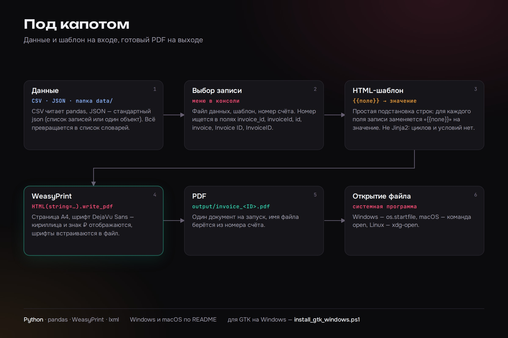

# PDF Generator — счета и документы из таблицы

Консольное приложение превращает строку из CSV или JSON в готовый PDF по HTML-шаблону. Вы выбираете файл с данными, шаблон и номер счёта, а программа подставляет значения полей в шаблон, собирает документ формата A4 и открывает его в системной программе просмотра. Кириллица и знак рубля отображаются корректно, шрифты встраиваются в файл. Суммы форматируются по-русски: `2 500,50`.

Подходит для типовых документов, которые приходится выпускать по таблице: счета, акты, справки. Свой шаблон добавляется обычным HTML-файлом в папку `templates/`.




## Возможности

- чтение данных из CSV и JSON;
- HTML-шаблоны с подстановкой `{{поле}}`;
- генерация PDF по выбранному номеру счёта (`output/invoice_<ID>.pdf`);
- автоматическое открытие PDF: Windows (`os.startfile`), macOS (`open`), Linux (`xdg-open`);
- поддержка кириллицы.

## Установка

1. Убедитесь, что у вас установлен Python 3.8 или выше

2. Установите зависимости:
```bash
pip install -r requirements.txt
```

3. **Для Windows:** WeasyPrint требует GTK+ библиотеки (см. также `INSTALL_WINDOWS.md` и `install_gtk_windows.ps1`). На macOS и Linux нужны системные библиотеки Pango, подробности в [документации WeasyPrint](https://doc.courtbouillon.org/weasyprint/stable/first_steps.html#installation). Для Windows установите GTK+ одним из способов:

   **Вариант 1 (рекомендуется):** Используйте установщик GTK+ для Windows:
   - Скачайте GTK+ с https://github.com/tschoonj/GTK-for-Windows-Runtime-Environment-Installer/releases
   - Или установите через MSYS2: https://www.msys2.org/
   - После установки добавьте путь к GTK+ в переменную окружения PATH

   **Вариант 2:** Используйте conda (если установлен):
   ```bash
   conda install -c conda-forge weasyprint
   ```

   **Вариант 3:** Используйте предкомпилированные библиотеки:
   ```bash
   pip install weasyprint[windows]
   ```

## Структура проекта

```
pdf-generator/
├── pdf_generator.py      # Основной скрипт
├── requirements.txt      # Зависимости
├── INSTALL_WINDOWS.md    # Установка GTK+ на Windows
├── install_gtk_windows.ps1
├── docs/                 # Схема и пример
├── data/                 # CSV и JSON файлы с данными
│   ├── sample_data.csv
│   └── sample_data.json
├── templates/            # HTML шаблоны
│   └── invoice_template.html
└── output/               # Сгенерированные PDF файлы
```

## Использование

1. Поместите ваши CSV или JSON файлы в директорию `data/`
2. Поместите HTML шаблоны в директорию `templates/`
3. Запустите скрипт:
```bash
python pdf_generator.py
```

4. Следуйте инструкциям в консоли:
   - Выберите файл с данными
   - Выберите HTML шаблон
   - Выберите invoice ID
   - PDF будет автоматически сгенерирован и открыт

## Формат данных

### CSV файлы
CSV файлы должны содержать колонку с invoice ID. Поддерживаемые названия полей:
- `invoice_id`
- `invoiceId`
- `id`
- `invoice`
- `Invoice ID`
- `InvoiceID`

### JSON файлы
JSON файлы могут быть:
- Массивом объектов: `[{...}, {...}]`
- Одиночным объектом: `{...}`

Каждый объект должен содержать поле с invoice ID (те же названия, что и для CSV).

## HTML шаблоны

В HTML шаблонах используйте двойные фигурные скобки для подстановки данных:
```html
{{invoice_id}}
{{customer_name}}
{{date}}
{{amount}}
```

Все поля из выбранной записи будут доступны в шаблоне.

## Примеры

В проекте уже есть примеры:
- `data/sample_data.csv` - пример CSV файла
- `data/sample_data.json` - пример JSON файла
- `templates/invoice_template.html` - пример HTML шаблона

## Требования

- Python 3.8+
- pandas
- weasyprint
- lxml

Генерация проверена на Linux проверена на примерах из `data/`.

## Устранение проблем

### Проблема: "cannot load library 'libgobject-2.0-0'" на Windows

Это означает, что GTK+ библиотеки не установлены. Следуйте инструкциям в разделе "Установка" выше.

### Альтернативные способы установки GTK+ на Windows:

1. **Через установщик (самый простой):**
   - Скачайте: https://github.com/tschoonj/GTK-for-Windows-Runtime-Environment-Installer/releases
   - Запустите установщик
   - Перезапустите терминал

2. **Через MSYS2:**
   ```bash
   # Установите MSYS2 с https://www.msys2.org/
   pacman -S mingw-w64-x86_64-gtk3
   ```

3. **Через conda:**
   ```bash
   conda install -c conda-forge weasyprint
   ```

## Примечания

- Поддержка кириллицы обеспечивается через шрифт DejaVu Sans
- PDF файлы сохраняются в директории `output/`
- После генерации PDF автоматически открывается в системной программе
- На Windows требуется установка GTK+ для работы WeasyPrint

## Лицензия

MIT — см. [LICENSE](LICENSE).
